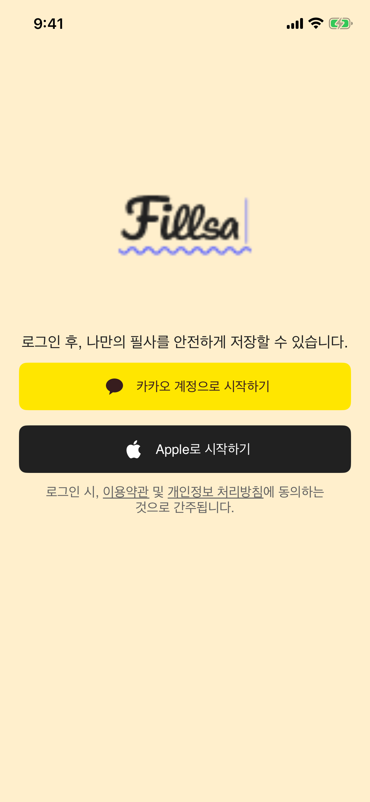

# iOS 회원 전용 시작 및 로그아웃 QA — 2026-10-09

- 대상 화면: 스플래시, 로그인, 회원 My Page
- UI 기준: 사용자가 이번 화면 이동 변경을 Figma 없이 진행하도록 명시적으로 요청했다. 기존 화면의 시각 일치 판정은 이번 QA 범위에 포함하지 않는다.
- 변경: 스플래시에서 첫 실행 기록과 인증 상태를 확인한다. 유효한 세션에서만 Home으로 이동한다. 회원 My Page에서 로그아웃하면 로그인 화면으로 이동하고 이전 회원 화면 상태를 초기화한다.

## 검증

| 항목 | 결과 | 근거 |
|---|---|---|
| 첫 실행 × 인증 상태 네 조합, 인증 조회 오류, 중복 완료 이벤트 | 통과 | `SplashFeatureTests` 6건 |
| 로그아웃 요청이 남은 토큰보다 우선, 재시작 후 유지, 새 로그인 후 해제 | 통과 | `SessionPersistenceTests` 3건 |
| 로컬 정리 성공·실패 시 화면 이동 이벤트 | 통과 | `MyPageFeatureTests` 2건 |
| 로그아웃 뒤 로그인 화면 이동 및 회원 화면 상태 초기화 | 통과 | `AppFeatureTests.test_logoutFromMyPageOpensLoginAndClearsMemberScreens` |
| 회원 My Page 버튼 탭 후 로그인 화면 표시 | 통과 | `MyPageUITests.test_memberLogoutOpensLogin` 및 아래 시뮬레이터 캡처 |

UI 테스트 첫 실행에서 버튼 행 가운데 탭이 무시되는 문제가 발견됐다. 로그아웃 버튼의 50pt 행 전체에 터치 영역을 지정한 뒤 같은 테스트가 통과했다.

전체 `xcodebuild test` 실행 결과는 170건 중 169건 통과, 1건 실패였다. 실패 항목은 이번 변경 대상 밖의 `HomeUITests.testStreakTooltipArrowIsAnchoredToStatusButton`이며, 툴팁 화살표 좌표가 기대값 90.33pt 대신 82pt로 측정됐다. 이 테스트만 단독 재실행해도 같은 값으로 실패했다. 로그아웃 관련 테스트는 전체 실행에서 모두 통과했다. 전체 실행 결과: `Test-Fiilsa-2026.10.09_15-21-36-+0900.xcresult`, 단독 재실행 결과: `Test-Fiilsa-2026.10.09_15-26-08-+0900.xcresult`.

## 남은 범위

로그인 닫기, 세션 만료, 회원 탈퇴, 남아 있는 비회원 액션의 Home 진입 경로는 이번 구현에 포함되지 않았다. 해당 경로는 [로그인 화면 계획](1_login.md)의 후속 검토 항목이다.
